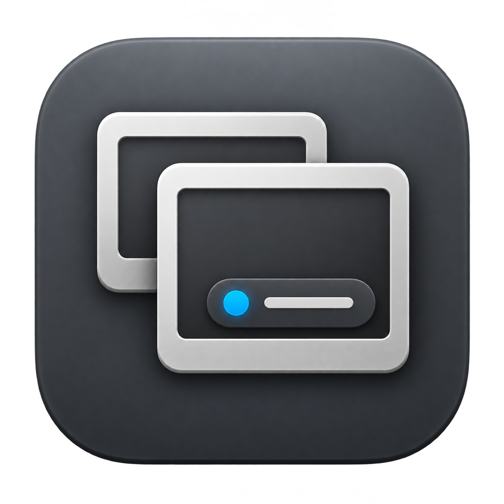

# CRD Window Studio

A native macOS companion for customizing the local sharing indicator shown by Chrome Remote Desktop.

[한국어](README.ko.md) | [Build and install](BUILDING.md) | [Privacy](docs/PRIVACY.md) | [Contributing](CONTRIBUTING.md)

The official Google host handles the remote connection. A separate Accessibility agent observes its sharing window and presents a configurable local indicator. This is an independent, unofficial project, not affiliated with Google or Apple.

## Features

- Native SwiftUI settings with Visibility, Position and Size, Appearance, and Troubleshooting. Korean and English follow the macOS or per-app language setting.
- Bar, capsule, compact, card, and status-dot layouts; saved position, dimensions, colors, opacity, and corner radius.
- A status dot with independent dot color, diameter, and surrounding padding. Double-click anywhere on it to expand a centered capsule containing the dot and Stop Sharing button; double-click the capsule outside Stop to shrink it back. Settings offer two ways to shrink it: until you shrink it yourself (stored as `stopRevealSeconds` 0), or automatically after 1 to 30 seconds.
- The custom window moves when dragged from anywhere (its own tracking loop, so macOS never tiles or enlarges it) and never takes a system resize. Lock Position and Lock Size are in the settings app and in the helper's right-click and menu bar menus.
- Presets save the window's look and position in `presets.json` beside `config.json`; apply them from the settings app or the helper's Presets submenu. Applying never changes the display mode or the on/off switch, and a position outside the display it will use is saved clamped inside it. Settings backups copy `presets.json` with the same identifier.
- Stop Sharing needs its own separate click: any other click or drag on the window, a menu, or a preset that moves Stop keeps it closed for a double-click interval.
- A menu bar menu that stays after the settings app closes: Replace Sharing Window, the display modes, Center Window, Lock Position and Lock Size, Presets, Open Settings, and Stop Sharing.
- Native context menus that dismiss on outside click or Escape, live previews, and Reduce Motion support.
- Local before/after geometry and settings logs, capped at 1 MiB. The running helper expires records after 24 hours. When it is stopped, expired records remain until the next helper start, `status`, or `restore`; disabling the helper keeps records still inside 24 hours.

The app offers two display modes: **custom** (the default) and **original**. First run and reset show the custom sharing window. A saved `hidden` mode loads as `custom`.

## Responsible use

Use this app only on Macs you own or administer, with the knowledge and consent of the people who use them. Follow local law.

The app changes only the local Chrome Remote Desktop notice window. It does not hide the session, the connection, or Google's own controls. The helper also keeps its own menu bar item. To bring the original notice back, choose **Original Sharing Window** under **Display Mode**, or use **Turn Off Window Helper**.

## Build and try

Requires macOS 14 or later, Swift 5.9 or later, Apple Command Line Tools or Xcode, and Python 3. There are no external Swift package dependencies.

```sh
./scripts/build.sh --all --universal
open "dist/CRD Window Studio.app"
```

The build and preview work without Chrome Remote Desktop installed. To control a real sharing window, first set up the official Google host and then follow [the installation steps](BUILDING.md#install-the-helper). The helper needs Accessibility permission; it does not request Screen Recording permission.

## How it works

```text
SwiftUI settings → validated JSON configuration → native Accessibility agent
                                               → local indicator + menu bar
                                               → separately installed Google host
```

The agent verifies the Google host's path and publisher, identifies the sharing window, and observes lifecycle events. It changes the host application's Accessibility hidden state; it does not patch its executable or load its libraries. Stop Sharing forwards an explicit user action to the identified original control.

The controller manages only its own per-user LaunchAgent. Settings persist outside Google's installation. See [architecture and recovery](docs/ARCHITECTURE.md) for the boundaries and limitations.

## Compatibility and current verification

| Area | Status |
|---|---|
| Deployment target | macOS 14+, arm64 and x86_64 builds |
| Runtime exercised | Apple Silicon, macOS 27.0.1, CRD host 155.0.8059.19 |
| Remote session | Manual checks cover connection/control/reconnection and dragging |
| Automated checks | Native fixtures, Swift tests, and mocked Python lifecycle/packaging tests; commands in [Building](BUILDING.md#verification) |
| Other Macs and future CRD releases | Require testing; build support is not a runtime guarantee |
| Windows | Optional read-only diagnostic source, not a Windows customization backend |

CRD updates can change Accessibility structure. When a compatible target cannot be established, the agent preserves or attempts to restore the original indicator instead of guessing. Abrupt termination and revoked permissions can delay restoration; see [recovery](BUILDING.md#recovery-and-removal).

By default, source builds use ad hoc signing, not Developer ID signing or notarization. A local signing identity is opt-in; see [Building](BUILDING.md). This repository does not claim a signed public binary release. The app does not repair CRD input bugs or replace Google's updater.

## Data and resource use

Settings are stored in `~/Library/Application Support/CRDWindowPatch/config.json`. Logs contain selected settings, geometry and lifecycle changes, not account names, session text, typed input, or authentication data. There is no project telemetry or network client. The separately installed Google host has its own data behavior. See [Privacy](docs/PRIVACY.md).

A 20-second idle sample with a remote session connected and the settings app closed shows about 0.05% of one CPU core and 99 MiB RSS for the helper. This single sample is not a performance guarantee or the cost of CRD screen encoding.

## Source layout

| Path | Purpose |
|---|---|
| `Sources/CRDWindowStudio/` | SwiftUI settings and preview |
| `Sources/CRDSettingsCore/` | Configuration, persistence, schema and localization |
| `backend/OverlayMain.mm` | Independent AppKit/Accessibility agent |
| `scripts/companionctl.py` | Helper lifecycle, permissions probe and status |
| `Tests/`, `tests/` | Swift and Python checks |
| `reference/` | Unmodified, separately licensed Chromium source references; not compiled |
| `windows/` | Optional Windows diagnostic and porting notes |

## License and project identity

Original project code and documentation are available under the [MIT License](LICENSE). Third-party files retain their own licenses; see [Third-party notices](THIRD_PARTY_NOTICES.md). The icon is independent project artwork; its provenance is in [assets/README.md](assets/README.md). No Google binaries or logos are distributed.

For changes, read [Contributing](CONTRIBUTING.md). For sensitive reports, read [Security](SECURITY.md). Maintainers can prepare a clean source release using [Releasing](docs/RELEASING.md).
